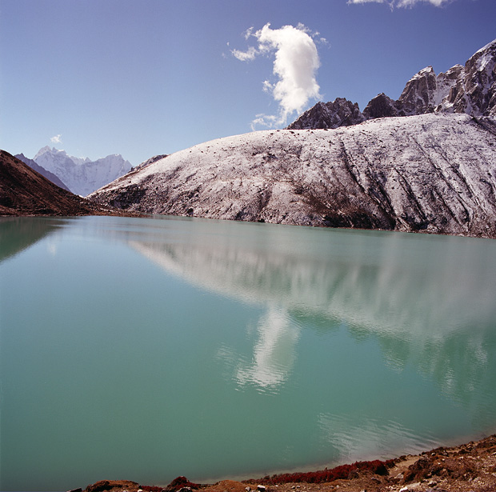
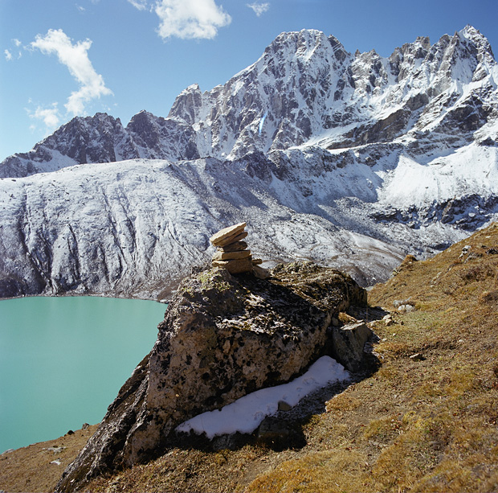

## #1. View over 3d Gokyo lake from Gokyo Ri (5,357 m)

## #2. View over 2d Lake and 3d Gokyo lake

## #3. Sunrise from the summit

## #4. Trekkers climb up to the summit

## #5. View over Renjo La pass and 3d Lake

## #6. View over 3d Gokyo lake

## #7. View over Gokyo village and 3d Lake

## #8. Prayer flags on the summit

*All pictures from Gokyo Ri taken with Hasselblad 500C/M camera*
