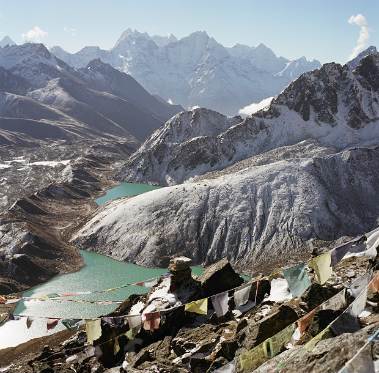
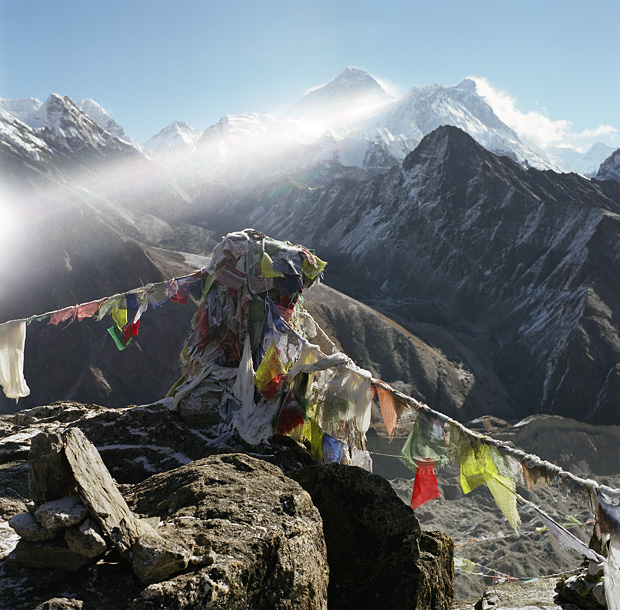
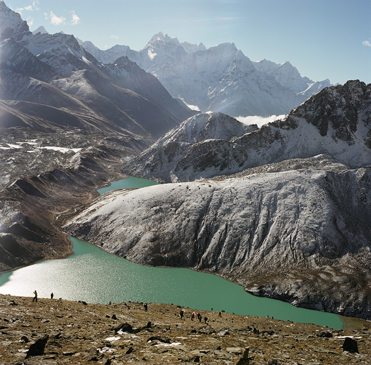
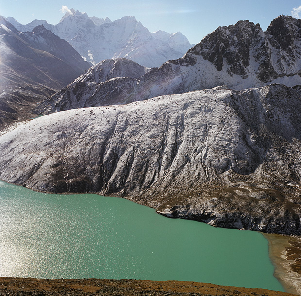
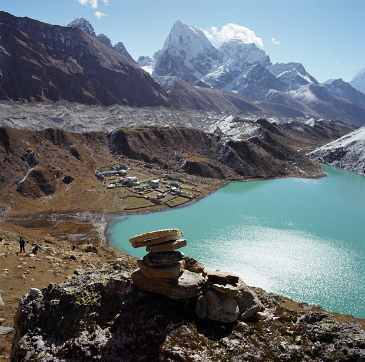
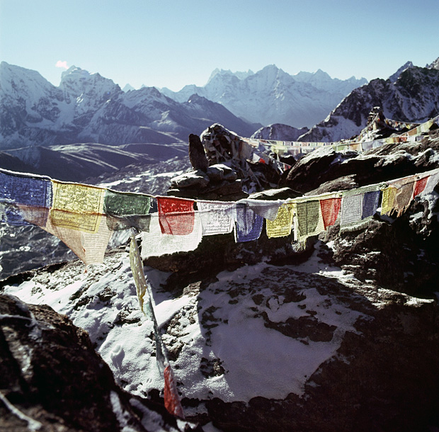

## #1. Best Pictures from Gokyo Ri: view over 3d Gokyo lake from Gokyo Ri (5,357 m)

## #2. Best Pictures from Gokyo Ri: view over 2d Lake and 3d Gokyo lake from Gokyo Ri (5,357 m)

## #3. Best Pictures from Gokyo Ri: sunrise from Gokyo Ri (5,357 m)

## #4. Best Pictures from Gokyo Ri: trekkers climb up to summit Gokyo Ri (5,357 m)

## #5. Best Pictures from Gokyo Ri: view over Renjo La pass and 3d Lake from Gokyo Ri (5,357 m)

## #6. Best Pictures from Gokyo Ri: view over 3d Gokyo lake from Gokyo Ri (5,357 m)

## #7. Best Pictures from Gokyo Ri: view over Gokyo village and 3d Lake from Gokyo Ri (5,357 m)

## #8. Best Pictures from Gokyo Ri: prayer flags on top of summit Gokyo Ri (5,357 m)

*All pictures from Gokyo Ri taken with Hasselblad 500C/M camera*
