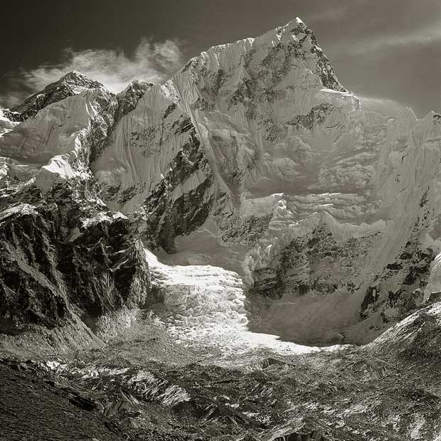
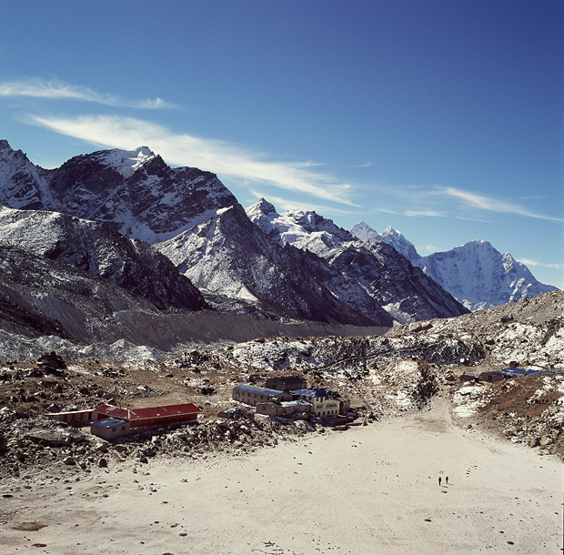
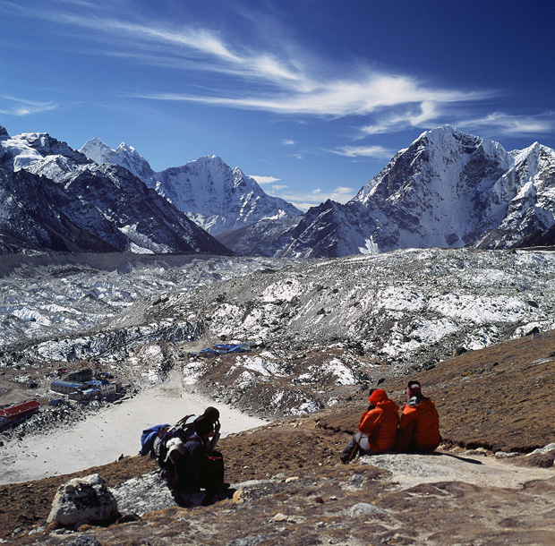
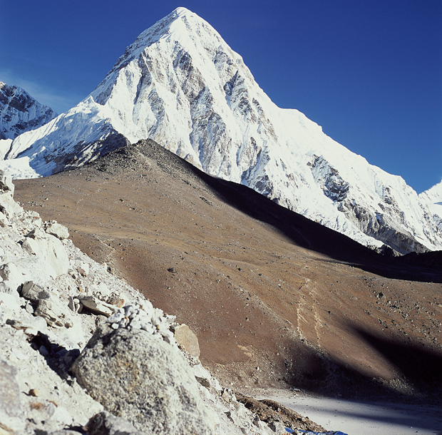
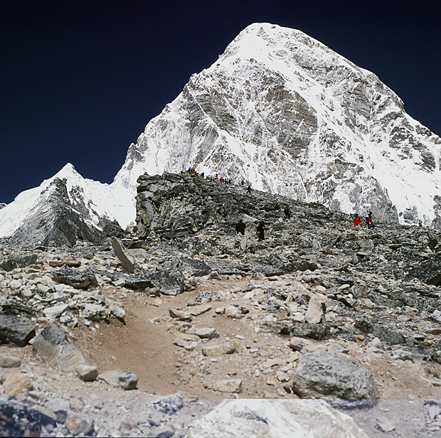

## #1. View over Lhotse (8,516 m) from Kala Patthar (5,545 m)

## #2. View over Gorak Shep

## #3. On the way back from the summit

## #4. View over Khumbu Icefall

## #5. Kala Patthar from Gorak Shep (5,164 m)

In background we can see the south face of summit Pumori (7,161 m).

## #6. Summit of Kala Patthar

The summit of Kala Patthar *(“the black rock” – meaning in nepali)* is final destination of Everest Base Camp Trek most of trekkers.

*All pictures from Kala Patthar taken with Hasselblad 500C/M camera*
