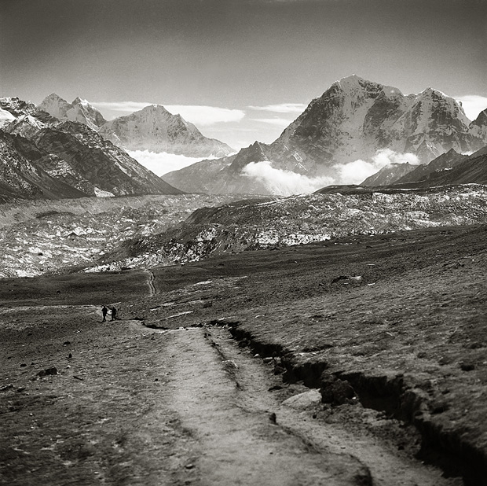

## #1. Best Pictures from Kala Patthar: view over Lhotse (8,516 m) from Kala Patthar (5,545 m)

## #2. Best Pictures from Kala Patthar: view over Gorak Shep from Kala Patthar (5,545 m)

## #3. Best Pictures from Kala Patthar: on a way back from summit of Kala Patthar (5,545 m)

## #4. Best Pictures from Kala Patthar: view over Khumbu Icefall from Kala Patthar (5,545 m)

## #5. Best Pictures from Kala Patthar: Kala Patthar (5,545 m) from Gorak Shep (5,164 m)

In background we can see the south face of summit Pumori (7,161 m).

## #6. Best Pictures from Kala Patthar: summit of Kala Patthar (5,545 m)

The summit of Kala Patthar *(“the black rock” – meaning in nepali)* is final destination of Everest Base Camp Trek most of trekkers.

*All pictures from Kala Patthar taken with Hasselblad 500C/M camera*
