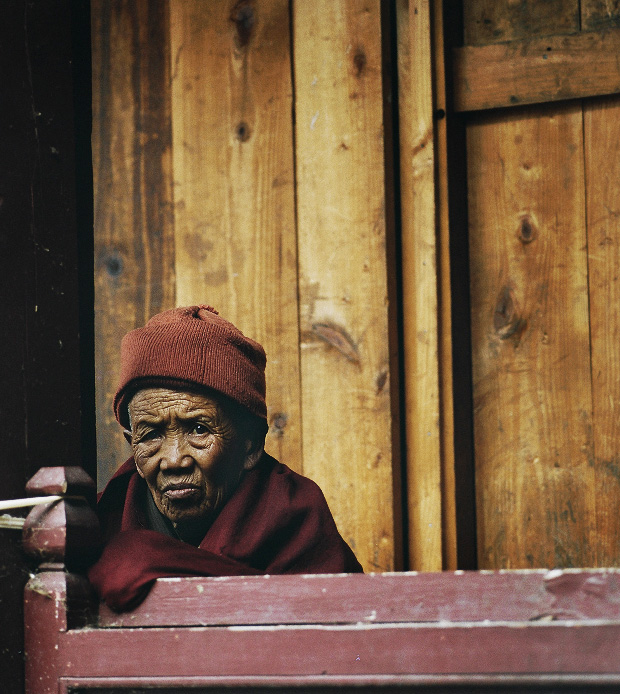
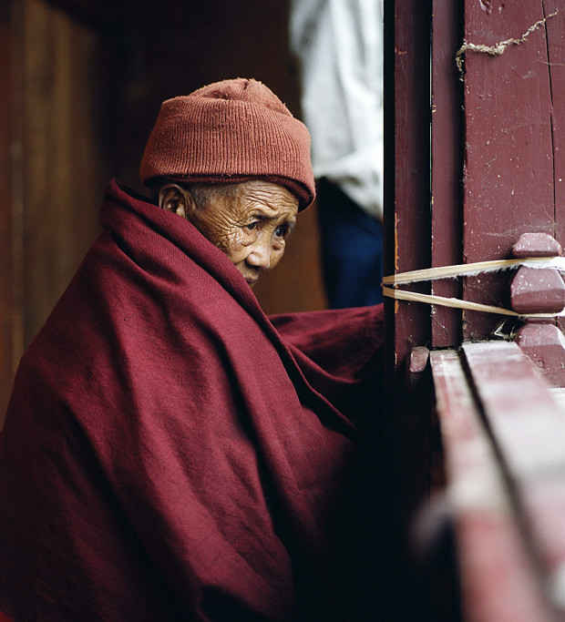
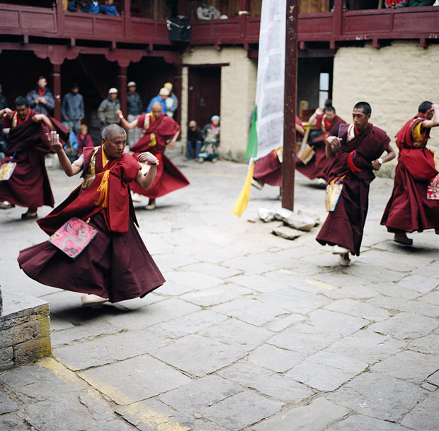
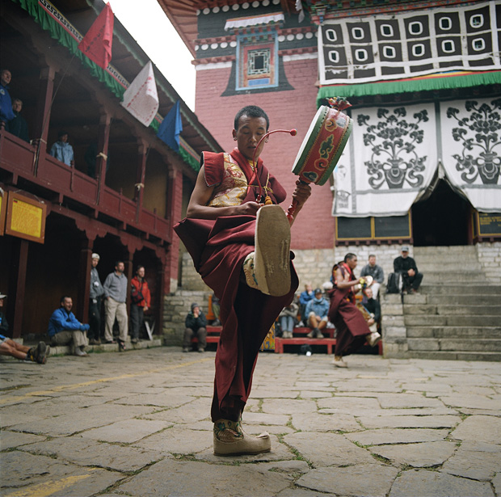
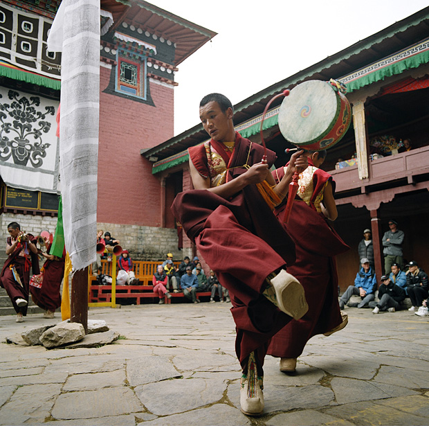
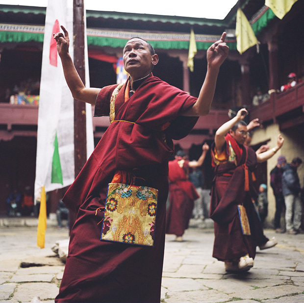

## #1. Best Pictures of Mani Rimdu festival in Tengboche Monastery: old Buddhist woman

## #2. Best Pictures of Mani Rimdu festival in Tengboche Monastery: Buddhist woman watching

## #3. Best Pictures of Mani Rimdu festival: Buddhist monk dance in the yard of Tengboche Monastery

## #4. Best Pictures of Mani Rimdu festival in Tengboche Monastery: Buddhist monk dancing

## #5. Best Pictures of Mani Rimdu festival: Buddhist monks dancing in Tengboche Monastery

## #6. Best Pictures of Mani Rimdu festival in Tengboche Monastery: Buddhist monks dancing

*All pictures from Mani Rimdu festival taken with Hasselblad 500C/M camera*
