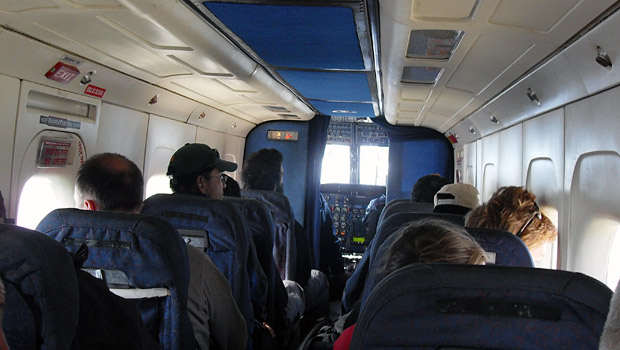
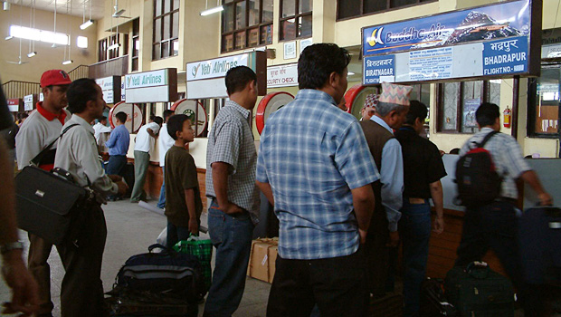

## Lukla – most important place in Nepal for trekkers

As the starting point for one of Nepal’s most popular trekking routes, the Everest Base Camp trek, for trekkers Lukla is one of the most important places in Nepal.

Other trekking routes in Khumbu region also begin in Lukla (2860 m). Khumbu is home to the Sherpas – one of the peoples who only inhabit this region of Nepal. The Khumbu region spans the locale of the eight-thousanders: Everest, Lhotse and Cho Oyu. Lukla is the starting point of trekking routes to the Everest Base Camp, to Gokyo Ri, to the trekking summits of Island Peak, Lobuche, Mera Peak, Kongma Ri, Kwande Ri and for the three mountain passes route: Renjo La Pass – Cho La Pass – Kongma La Pass.

Almost all the local small airlines fly to Lukla: Yeti Airlines, Agni Air, Sita Air, Gorkha Air and Shangrila Air. However, of greater importance is not the airline, but actually getting hold of tickets to Lukla. This is your first task upon arrival in Kathmandu. That is, of course, if you’re planning to trek towards the Everest Base Camp.

## Air Tickets to Lukla

Tickets for domestic flights within Nepal can be bought at any trekking (travel) agency. And in that part of the capital Kathmandu that is most popular with trekkers – Thamel, there are as many travel agencies as shops. If you look around, you’ll find the occasional one-stop trekking agency and trekking goods store. Don’t bother looking for any airline offices. And forget about trying to book tickets on the Internet.

  

And furthermore it’s a waste of time trying to identify any strict systems or logicalities in Nepal. Everything occurs very simply here. Just approach anybody on the street and in 24 hours you’ll be sitting on an elephant in Chitwan National Park or trekking to the Everest Base Camp.

In other words, Nepal functions on the basis of mutual friendships. If you’ve arrived in Kathmandu without any contacts and have a few hours time; start with your hotel administrator. He’ll definitely recommend a friend of his who’ll be able to organise everything you need for trekking.

Beyond this point, everything depends on your ability to haggle and make yourself understood. In addition to selling you your tickets to Lukla, it’s a sure thing that the agent will try to talk you into hiring his wonderful trekking guide and porters. And you’ll definitely need them in Lukla unless you’re a veteran Everest Base Camp trekker and are willing to break your back hauling your bags.

However, if you want to get a second opinion on the prices quoted by the agent, you’d be well advised to shop around and get a quote from at least 2-3 trekking agencies or just sign up immediately with the one that seems most trustworthy. In spite of occasional appearances to the contrary, experience shows that the people of Nepal are very honest and fulfil every agreement they undertake.

As soon as you’ve reached an agreement, the agent will call the airline, check out the flight options and free seats, and issue your tickets. The agency will charge a USD 5 commission fee for the ticket. The price of airline tickets is fixed and leaves no room for haggling. Tickets are torn off a pad in the form of a simple receipt, stamped, signed and lo and behold your journey to Lukla is about to begin.

## Flying to Lukla (LUA)

Flights to the Lukla mountain Airport (LUA, 2,860 m) named in honour of Tenzing-Hillary usually depart early morning between the hours of 07:00 – 10:00. Most mornings the weather in the mountains is clear and the land isn’t frozen which means less turbulence during the flight. In 2009 due to a surge in the number of trekkers, afternoon flights to Lukla also began.

Departures take place from the Kathmandu Domestic Airport which adjoins Tribhuvan International Airport. You should arrive at the airport at least one hour before departure. The flight takes approximately 30 minutes and the most exciting moments come on the approach to Lukla Airport and landing.

Whether or not you actually get to fly to Lukla greatly depends on the weather conditions. Local pilots fly according to visual navigation principles and in conditions of smog or during foggy weather, flights tend to be cancelled or planes from Lukla will divert trekkers in tow to Kathmandu, because they were unable to land at Lukla.

An example of this occurred during our third trip to Nepal in early October 2007. Our morning exercise routine consisted of a 06:00 drive to the airport – check in, baggage weighing, security check and drive back to the hotel that was conducted three times in a row. On the first two days, after several hours lounging around on our bags in the departure zone at Kathmandu Domestic Airport, sometime between 13:00 and 14:00 we received the airport’s announcement that that day’s flights to Lukla had been cancelled due to fog.

On the third day our Nepalese friends offered to fly us to Lukla by helicopter. Thus, we reached Lukla successfully and, one has to admit, more comfortably than on a scheduled plane. However, a group of trekkers from Russia, in whose company we’d spent the two previous days sitting on bags at the airport, was forced to change its route and trek to Annapurna.

Among the most challenging weather conditions in Nepal are those that occur at the mountain airports of Lukla and Jumla where the weather can alternate radically from clear sunshine to a damp fog with drizzle within 15 minutes. This is why Lukla is considered to be one of the world’s most dangerous airports. Weather conditions occur particularly fluctuate at the start of the autumn tourism season after the monsoon period (end of September – start of October) when the mountains are shrouded by frequent and rapidly changing fogs. There is a belief that if the weather in Kathmandu is good and clear, the weather conditions in Lukla will be poor and vice versa.

If you’re planning the Everest Base Camp trek in the Khumbu region, it is recommended that you allocate a few reserve days in case your flights are delayed. You’ll be better off spending the remaining time discovering Kathmandu instead of missing your major flight home or trying to transfer tickets from nowhere.

## Baggage weight, airport duties in Nepal and other details

Unlike the standard practice and strict baggage weights limits in the rest of the world, in Nepal there are either none at all or else they’re very high. What’s quite clear is that trekkers head into the mountains packed to the teeth. Fortunately, thus far in my Nepal travel history, I’m yet to suffer the cost of any excess baggage. This tends to affect bigger groups of trekkers more. Usually, baggage is weighed for the whole trekkers’ group together with the average weight per person then being calculated.

On local flights in Nepal, including on the flight to Lukla you have to pay a small airport duty of approximately USD 10 at the airport. You’ll be notified of this at the registration desk. This duty is not included in the ticket price.

And a word of warning – an indescribable ruckus almost inevitably greets you at all local airports in Nepal. Both foreign trekkers like us and the wealthiest local fly from here.

  

In addition to trekkers’ rucksacks, items loaded onto planes include eggs, domestic fowl, sacks of sugar, flour and other household goods. You may even find yourself having arrived at the airport in good time, only to discover that registration for your flight has not even begun. Nothing ever surprises you in Nepal. All you have to do is wait and keep your eyes open as to what’s going on around you.

When registration begins, airline employees will announce this by shouting across the hall. At this point, the ruckus will double on both sides of the registration desk, so just be patient… This is Nepal and ultimately you’ll successfully arrive at your destination, in this case – Lukla.

 Continue reading about Everest Base Camp Trek:  
 [Altitude acclimatization](/altitude-acclimatization-for-trekking-10-golden-rules/ "Altitude acclimatization for trekking – 10 golden rules")
