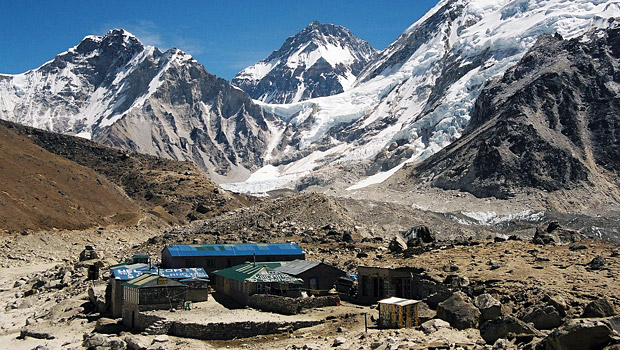

## Internet and 3G mobile phone coverage at Everest Base Camp

Mobile communications are now available to the mountain climbers in the highest mountain of the world Mount Everest and in Everest Base Camp – it is possible to make video calls and browse the internet on the mobile phones, a Nepalese telecommunication company called **Ncell** announced Friday, October 29, 2010.

  

**Ncell**, the Nepalese subsidiary of Swedish phone company **TeliaSonera**, has set up 3G base station of broadband mobile communications in the altitude of 5,200 metres, in the village of Gorak Shep. Gorak Shep is the last settlement on the side of Nepal on Everest Base Camp trek just before Everest Base Camp.

“Today we made the world’s highest video call from Mount Everest Base Camp successfully,” announced the representative of **Ncell**. “The coverage of the network will reach up to the peak of the Everest.” Previously, the climbers who reached Everest’s 8,848-metre peak depended on the expensive satellite phone coverage, provided by Inmarsat.

The 3G base station of mobile communications will also help tens of thousands of trekkers who visit the Everest Base Camp every year with the aim to reach the Everest Base Camp itself (5,320 m) or the nearby peak of Kala Pathar (5,545 m).

The 3G services will be fast enough so that the climber could make video calls and use the Internet, said the representative of **TeliaSonera**. In total eight base stations have been installed in the Everest region, four of them are powered by solar energy.

The lowest is set up at Lukla (2,870 m), where thousands of trekkers arrive every year to hike to Everest Base Camp.

  

The climbers have already named the establishment of the base stations as ambitious and helpful project: “The expensive satellite connections that many times does not work for days will be replaced with this service, making it possible for all climbers to keep in touch with their organisers and family,” said Ang Tshering Sherpa, a member of the International Mountain Protection Commission.

**TeliaSonera** announced that next year it has planned to invest 100 million dollars (50,9 million lats) to ensure the mobile coverage for more than 90 percent of Nepal’s population, since now the mobile services coverage is ensured for less than a third of population. When I participated in the trekking to Everest Base Camp in the autumn of 2007, mobile phone services were available only from Lukla to Tengboche (3,860 m).

 Read more about Everest Base Camp Trek:  
 [High Altitude Sickness](/high-altitude-sickness/ "High Altitude Sickness")
